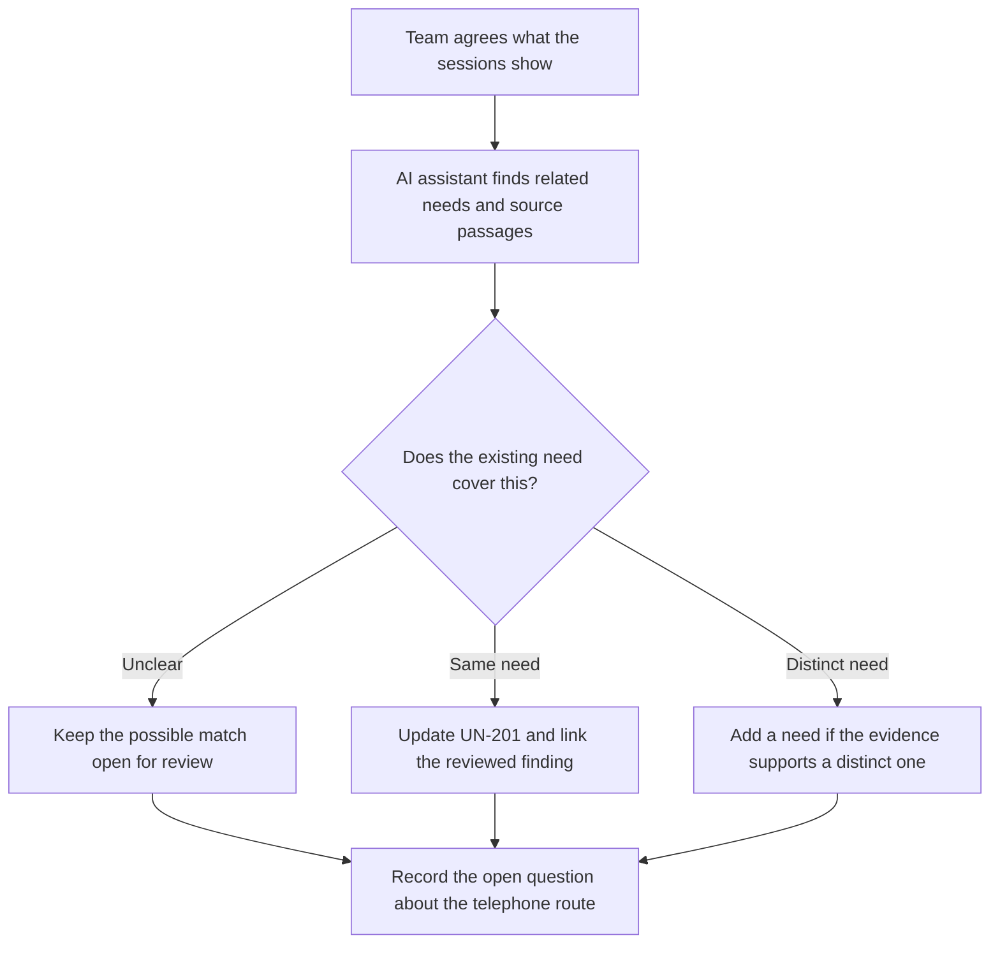
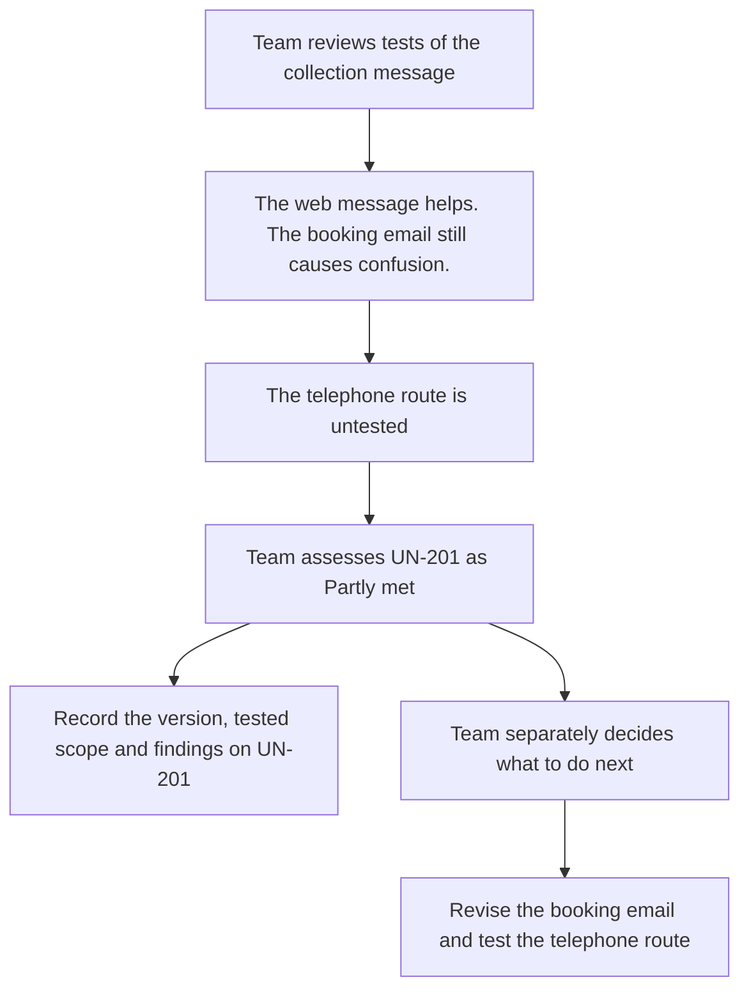
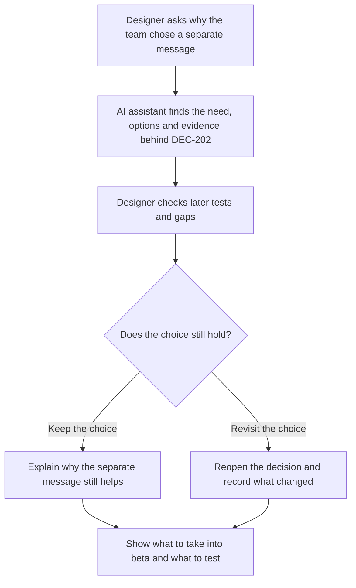

# UCD Project Foundations

A framework for user-centred design teams to keep research findings, user needs and decisions easy to find. See what the team agreed, why it made those decisions and what evidence supports them. An AI assistant can help find and check the records.

**Version 0.6.2 · 28 November 2026 · for peer review**

## Why the framework exists

Can we improve the quality and effectiveness of user-centred design projects by making research, user needs and decisions easier to find, understand and use?

An answer can be in the project files with no clear way to find it. Findings, user needs and decisions can be buried in documents named for meetings or project phases. An AI assistant can miss the relevant source and give an answer based on only part of the evidence.

Each kind of information has a named home. Links let a team follow a design choice back to the user need, finding and source that informed it.

## Start here

1. Download the [v0.6.2 starter ZIP](https://github.com/Miles-Cheverton/user-centred-design-framework/releases/download/v0.6.2/ucd-project-foundations-v0.6.2.zip) into your approved workspace and open the README inside.
2. Name the service in the [project README](framework-template/README.md). Update [project config](framework-template/_project-config.md) if your team needs different working arrangements.
3. Start with the [problem statement](framework-template/how-to/project-setup-and-management.md#problem-statement), or use [Import an existing project](framework-template/AI-skills/import-existing-project/SKILL.md) if work is under way.

The [development template](framework-template/) may include changes that have yet to be released.

The [how-to guide](framework-template/how-to/README.md) shows which files to use for common tasks. The [worked equipment depot example](framework-template/how-to/worked-examples.md#collection-readiness-at-an-equipment-depot) follows a finding from its source to a decision and outcome.

## Core principles

**People think first. AI helps second.** Give people time to form their own ideas, compare what they noticed and work out what the evidence supports before they see an AI summary. An early summary can steer the discussion towards one interpretation. Hearing from people first makes room for different ideas. Then use AI to check sources, spot gaps and fill in the details of what the team agreed.

Use the records that help with the work in front of you. Keep source material in the tools your team already uses and link to the version you relied on. The framework draws on GDS guidance and works with or without an AI assistant.

## What you get

- An Excel document tracker for finding current project records and additional files.
- Excel workbooks for structured records, including scope, project people, design artefacts, and functional and non-functional requirements. Related outcomes and research planning records use clearly named tabs. Start with empty records; the ID column guidance shows example IDs.
- A Markdown problem statement and guides to completing the records.
- Folders for research rounds, optional research templates and journey diagrams. The design artefacts register links to exact journey and prototype versions in the tools you use or to saved files.
- [Reusable AI skills](framework-template/AI-skills/README.md) and a [library of 17 copy-and-paste prompts](framework-template/AI-skills/prompt-library.md) for common team tasks, whether or not the skills are installed.
- An optional project health report, generated on request and refreshed after verified AI-assisted record updates. It shows recorded statistics, gaps and integrity issues without becoming another record to maintain.

Use the template for the whole service, including staff and operations and the routes people use offline. Keep real participant data and research material in approved storage with the right permissions. The starter contains placeholders and fictional examples.

## Intended benefits

- Help new team members find the evidence and reasoning behind decisions.
- Reduce the effort of searching project files so the team can spend more time interpreting what it finds.
- Reduce time spent finding and checking material for discovery, alpha and beta presentations.
- See which user needs the service meets in full, which it partly meets and what still needs testing.
- Find unanswered questions and gaps in the evidence behind a decision.

## Example workflows

These examples follow a fictional equipment depot. Borrowers need to know when their equipment is ready so they can plan their trip (`UN-201`). The last two examples imagine what happens after the [worked equipment depot example](framework-template/how-to/worked-examples.md#collection-readiness-at-an-equipment-depot).

### After a research debrief

The team compares notes and agrees what the sessions show. A borrower made a trip before the equipment was ready. [Capture or update records](framework-template/AI-skills/capture-or-update-records/SKILL.md) finds an existing need about knowing when to travel and points to the relevant session evidence. The team checks the match, updates `UN-201` with the evidence and records a question about what telephone borrowers are told.

View the research debrief workflow

### After testing a design

In alpha, the team tests a separate collection message. Web borrowers who see it know when to travel, but some mistake the earlier booking email for permission to collect. The team marks the need **Partly met**, links the findings and records that the telephone route is still untested. It then decides to revise the booking email and test with telephone borrowers. [Assess whether the service meets the need](framework-template/how-to/design-and-development.md#assess-whether-the-service-meets-the-need)

View the design testing workflow

### When revisiting a decision

Preparing for alpha exit, the service designer asks why the team chose to test a separate collection message. [Find and explain](framework-template/AI-skills/find-and-explain/SKILL.md) traces `DEC-202` to `UN-201`, the option the team set aside and the evidence it had at the time. Later testing shows why the separate message helps and why the booking email still needs work. The designer checks the evidence and uses it to explain what the team recommends taking into beta and what still needs testing.

View the decision review workflow

## Feedback and reuse

Peer feedback is welcome. Which records would help your team? What was hard to find or would add unnecessary admin? [Share feedback on GitHub](https://github.com/Miles-Cheverton/user-centred-design-framework/issues)

The framework is licensed under [CC BY 4.0](repository-info/LICENSE), copyright 2026 Miles Cheverton. You can reuse and adapt it, including commercially, with attribution, a licence link and an indication of changes. Third-party material retains its own terms. [Standards and sources](repository-info/standards-and-sources.md) explain the practices that informed the draft.
